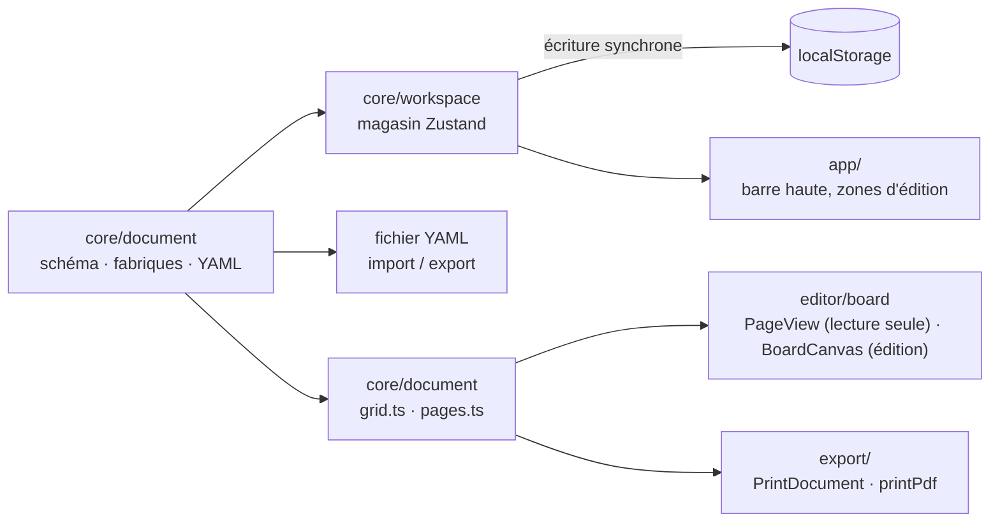

# Architecture

La forme technique d'ensemble : la pile, l'articulation des pièces, les décisions. Pointer vers le code, ne pas le recopier.

## Pile

- TypeScript + React sur Vite. Application cliente pure, compilation statique, aucun serveur.
- Zustand pour l'unique magasin de l'espace de travail ; Zod pour valider le document ; `js-yaml` pour le fichier d'échange.
- Tailwind avec shadcn/ui sur le paquet unifié `radix-ui` ; `lucide-react` pour les icônes ; `sonner` pour les notifications.
- vitest + jsdom pour les tests unitaires.

## Articulation

## Décisions

- **Un seul schéma décrit tout ce qui s'exporte** (`src/core/document/schema.ts`). Les règles croisées (cadre hors grille, image absente, image posée deux fois, identifiants en double) sont dans le même schéma, pas dans l'interface : un fichier écrit à la main est tenu aux mêmes règles.
- **`doc` et `view` sont séparés** (`src/core/workspace/types.ts`), comme dans Lantern. Seul `doc` franchit la frontière du fichier YAML ; tout état d'interface rangé dans `doc` fuirait dans chaque export.
- **Clés du document en français, identifiants de code en anglais.** Le fichier YAML est lu et écrit par la personne ; le code suit les conventions de Lantern.
- **L'échec d'écriture locale se voit.** Contrairement à Lantern, le magasin garde `saveError` dans son état et l'application affiche un bandeau tant que l'échec dure (`src/core/workspace/store.ts`, `src/App.tsx`).
- **Un instantané illisible n'est pas écrasé en silence** : il est copié sous `atelier:workspace:v1:illisible` avant le repli sur un espace vide.
- **Écriture YAML stable** : `serializeDocument` reconstruit l'ordre des clés, pour que deux exports du même document soient identiques octet pour octet.
- **Dimensions de page en pixels CSS à 96 px par pouce**, arrondies (`src/core/document/formats.ts`). A4 fait 794 × 1123 px pour 793,7 × 1122,5 réels : à surveiller à l'impression.
- **Une seule géométrie pour l'édition, la lecture seule et l'impression** (`src/core/document/grid.ts`) : le rectangle d'un cadre vient de `calcGridItemPosition` de `react-grid-layout/core`, avec `rowHeight = (hauteur − 2·marge − gouttière·(rangées−1)) / rangées`. `PageView` et `BoardCanvas` passent par les mêmes paramètres.
- **react-grid-layout 2.3 est retenu, en le contraignant** (essai fait sur le vrai composant, à l'échelle 1 et 0,578). Aucun tassement et collisions bloquées : `compactor = { ...noCompactor, preventCollision: true }`, `autoSize={false}`. Redimensionnement borné au bord de la grille : conforme. Le déplacement refusé retrouve sa position (la grille est contrôlée, `revision` la remonte).
- **Sous un parent réduit par `transform: scale`, deux comportements de la bibliothèque sont faux** : le dépôt natif (`computeDropPosition` / `calcXY` reçoivent des pixels écran non divisés par l'échelle) et `createScaledStrategy` (division en double avec le `transformScale` de react-draggable, d'où un glisser décalé). Retenu : `positionStrategy = { ...transformStrategy, scale }`, et le dépôt natif géré par la surface elle-même avec `calcXY` (`BoardCanvas.tsx`).
- **Impression** : `@page { size: Wmm Hmm; margin: 0 }` injecté à l'impression (`printPdf.ts`) ; chaque planche est dans une section en millimètres qui rogne le débord des pixels arrondis ; `PrintDocument` est monté en portail sur `document.body`, le reste est `display: none` (`print.css`). Constaté en Chromium : une page par planche, dimensions exactes pour les six formats, aucune page blanche. **Firefox n'est pas testé.**
- **L'apparence passe par des variables CSS `--board-*`** posées par `appearanceVars` (`src/core/document/appearance.ts`) sur la planche, en édition (`BoardCanvas`) comme en lecture seule (`PageView`) ; les styles sont dans `board.css`. Marge et gouttière sont bornées par `effectiveSpacing` (`grid.ts`) pour que les cellules restent positives. Les trois polices sont embarquées (`@fontsource`), donc rendues sans réseau.
- **Fichiers locaux en IndexedDB, hors du document** (`src/core/assets/`). Un fichier remplace le lien d'une image pour l'affichage et l'export, clé `${documentId}:${imageId}`. `localSources.ts` tient en mémoire le registre des adresses d'objets, lu par `useImageSource` (composants) ou `localSourceOf` (code sans React : magasin, impression, export). Rien n'en passe dans le YAML.
- **Capturabilité** (`capturability.ts`) : une capture lit les pixels, donc l'image doit être servie avec les en-têtes inter-domaines. Le contrôle fait un `fetch` en mode `cors`, abandonné dès les en-têtes, mémorisé par lien ; `data:` et `blob:` passent toujours.
- **Export PNG** (`src/export/exportPng.ts`) : la planche `PageView` est montée hors de la vue (`position: fixed; left: -100000px`) à ses dimensions réelles, puis capturée par `@zumer/snapdom` (`scale`, `dpr: 1`, polices embarquées). `dpr: 1` fixe la taille du fichier à format × échelle quel que soit l'écran. snapdom est chargé à la demande (≈ 260 kB). Constaté en Chromium : 794 × 1123 à ×1, 1588 × 2246 à ×2 ; une image non lisible sort en bloc gris `#ccc` portant « img », et la capture signale un `warnings[].code === 'image-fallback'` que l'interface rapporte.
- **`view.selectedImageId` sert aussi à sélectionner un cadre** : une image n'étant posée qu'une fois, image et cadre se confondent.

## Stockage local

Clé `atelier:workspace:v1`, valeur `{ version: 1, documents: [{ id, doc, view }], activeId }`. Chaque `doc` est revalidé par le schéma à l'hydratation.

## Pièges

- **pnpm 12 ne s'installe pas sur ce poste.** Le plan visait pnpm 12 ; `pnpm@12.11.2` échoue (`No matching version found for @pnpm/win-x64@12.11.2`) et `pnpm@11.28.2` aussi (`Failed to switch pnpm to v11.28.2 … ENOENT`), en restant parfois bloqué. `packageManager` est donc fixé à `pnpm@10.34.6`. Node 24 est bien fourni par `devEngines.runtime` (`onFail: download`) alors que le poste reste en Node 23.
- **`shadcn add` interprète mal l'alias `utils`.** Avec `utils: "@/utils/cn"` dans `components.json`, les composants générés importent `from "cn"` et l'outil installe un paquet npm `cn` sans rapport. Après chaque ajout : corriger l'import en `@/utils/cn` et retirer le paquet. `sonner` amène aussi `next-themes`, inutile ici.
- **`fake-indexeddb` et le Blob de jsdom** : le Blob de jsdom est perdu au clonage structuré. `localFiles.test.ts` tourne donc en environnement Node (`// @vitest-environment node`).
- **`src/components/ui/` garde le style de shadcn** (2 espaces, guillemets doubles) tant que `pnpm format` n'a pas été lancé dessus.
- **`__APP_VERSION__`** est injecté par `vite.config.ts` depuis `package.json` et affiché dans la barre haute.
