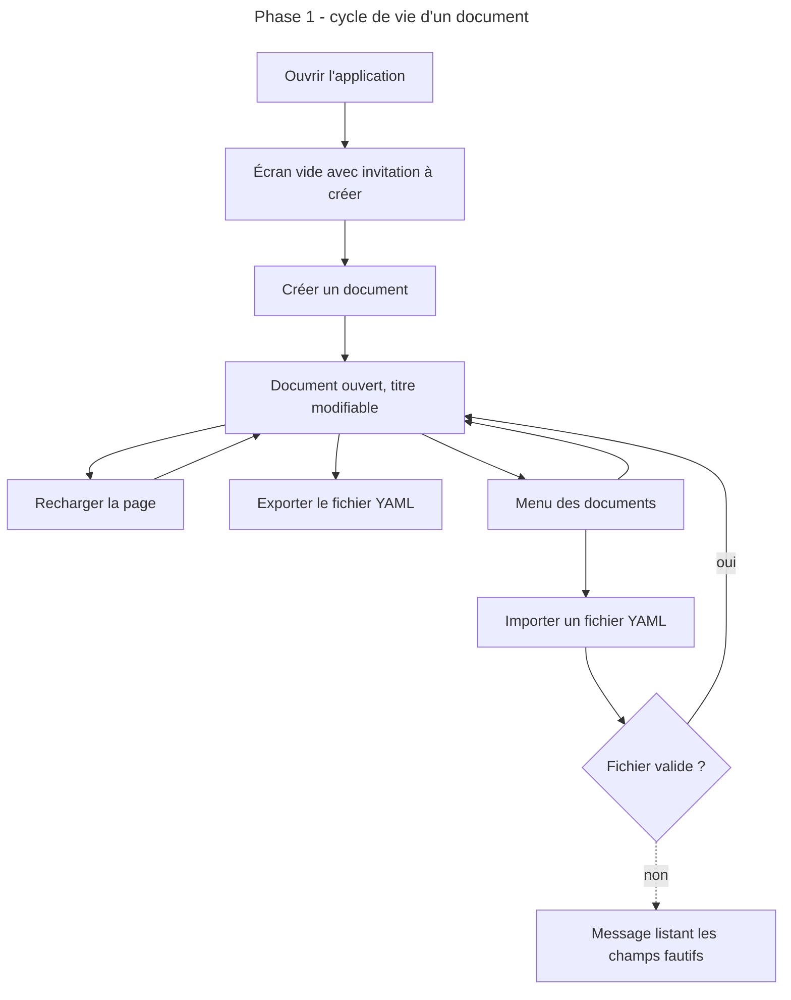
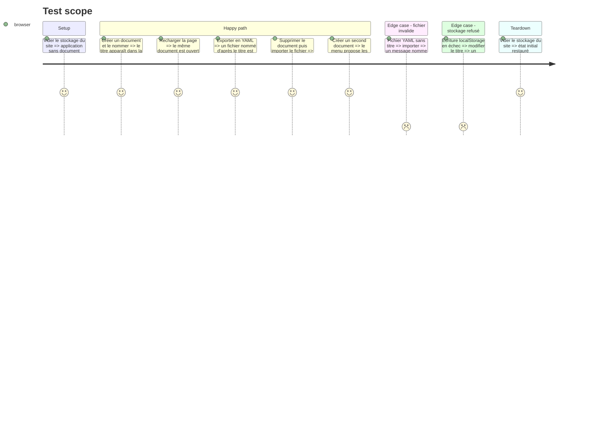

# Instruction: Socle, document et persistance

## Architecture projection

> Tree of the final files. ✅ create · ✏️ modify · ❌ delete

```txt
Moodboard/atelier/
├── ✅ package.json                 scripts dev, build, lint, format, test ; packageManager pnpm 12 ; devEngines.runtime Node 24
├── ✅ pnpm-lock.yaml
├── ✅ .gitignore                   repris de Lantern, sans la partie Nix
├── ✅ .prettierrc                  repris de Lantern, tailwindStylesheet pointé sur src/styles/index.css
├── ✅ eslint.config.js             repris de Lantern
├── ✅ components.json              shadcn, css sur src/styles/index.css, utils sur @/utils/cn
├── ✅ tsconfig.json
├── ✅ tsconfig.app.json
├── ✅ tsconfig.node.json
├── ✅ vite.config.ts               alias @, __APP_VERSION__, configuration vitest
├── ✅ index.html                   lang fr, aucune police distante
├── ✅ CLAUDE.md                    consignes et bloc mémoire, sur le modèle de Lantern
├── ✅ README.md
├── ✅ aidd_docs/memory/project-brief.md
├── ✅ aidd_docs/memory/architecture.md
└── src/
    ├── ✅ main.tsx
    ├── ✅ App.tsx                  coquille : barre haute, zone d'édition
    ├── ✅ vite-env.d.ts
    ├── styles/
    │   ├── ✅ index.css
    │   ├── ✅ theme.css            jetons shadcn
    │   └── ✅ base.css
    ├── utils/
    │   ├── ✅ cn.ts
    │   └── ✅ clone.ts
    ├── components/ui/              ✅ sous-ensemble shadcn : button, input, textarea, label, dialog,
    │                                  alert-dialog, dropdown-menu, select, switch, separator,
    │                                  scroll-area, tooltip, badge, sonner
    ├── core/document/
    │   ├── ✅ schema.ts            schéma Zod du document
    │   ├── ✅ schema.test.ts
    │   ├── ✅ formats.ts           formats de page et dimensions en pixels CSS
    │   ├── ✅ model.ts             fabriques : document vide, planche vide, identifiants
    │   ├── ✅ yaml.ts              lecture et écriture du fichier YAML
    │   └── ✅ yaml.test.ts
    ├── core/workspace/
    │   ├── ✅ types.ts
    │   ├── ✅ store.ts             magasin Zustand, persistance localStorage
    │   ├── ✅ store.test.ts
    │   └── ✅ selectors.ts
    └── app/
        ├── ✅ AppTopBar.tsx        titre du document, menu des documents, import et export YAML
        ├── ✅ DocumentMenu.tsx     menu de la barre haute : créer, ouvrir, renommer, dupliquer, supprimer
        ├── ✅ AppEmptyState.tsx
        └── ✅ EditorView.tsx       cadre à trois zones, vides à ce stade
```

## User Journey



## Test Scope



## Wireframe

```txt
┌──────────────────────────────────────────────────────────────────────────────┐
│ (1) Barre haute : titre · [Documents ▾] · Importer · Exporter YAML · version  │
├───────────────┬──────────────────────────────────────────────┬───────────────┤
│ (2) Réserve   │ (3) Zone des planches                         │ (4) Inspecteur │
│               │                                               │                │
│  vide à ce    │   vide à ce stade :                           │  vide à ce     │
│  stade        │   invitation à créer ou à ouvrir un document  │  stade         │
│               │                                               │                │
└───────────────┴──────────────────────────────────────────────┴───────────────┘
```

1. Barre haute : identité du document ouvert, menu de la bibliothèque locale (créer, ouvrir, renommer, dupliquer, supprimer), entrées et sorties de fichier.
2. Réserve : recevra les images en phase 2.
3. Zone des planches : recevra les planches en phase 3.
4. Inspecteur : recevra les formulaires aux phases suivantes.

## Tasks to do

### `1)` Amorcer le projet

> Un projet Vite qui compile, se lance et se vérifie, calqué sur Lantern.

1. Créer `Moodboard/atelier/` et y initialiser un dépôt git, sans commit.
2. `package.json` : `packageManager` sur pnpm 12.11 (le pnpm 10.5 du poste télécharge et utilise de lui-même la version déclarée) et `devEngines.runtime` sur Node `^24.15.0` avec `onFail: download`, pour que pnpm fournisse Node 24 au projet. Ne pas utiliser `useNodeVersion`, retiré depuis pnpm 11.
3. Confirmer dans le dossier du projet que `pnpm --version` répond 12 et qu'un script lancé par `pnpm run` tourne en Node 24. Si l'un des deux échoue, s'arrêter et demander avant toute mise à jour de pnpm ou de Node sur le poste.
4. Reprendre de `obsidian/lantern` comme modèle, en les adaptant aux versions ci-dessous : `.gitignore` (sans Nix), `.prettierrc`, `eslint.config.js`, `tsconfig*.json`, `vite.config.ts`, `components.json`. Corriger les deux chemins que la mémoire de Lantern signale comme faux (`src/styles/index.css`, `@/utils/cn`). Ne pas reprendre de `vite.config.ts` le découpage manuel des lots ni `define: { global: {} }`, propres aux dépendances de Lantern.
5. Déclarer les dépendances aux dernières versions stables (relevé du 2026-10-12, à reconfirmer à l'installation) :

   | Paquet | Version | Note |
   | --- | --- | --- |
   | react, react-dom, @types/react | 19.3 | |
   | vite | 8.3 | Lantern est en 7 |
   | @vitejs/plugin-react | 6.1 | exige Vite 8 |
   | typescript | 6.0.3 | pas 7 : exclu par typescript-eslint |
   | tailwindcss, @tailwindcss/vite | 4.3 | |
   | zod | 4.6 | |
   | zustand | 5.0 | |
   | js-yaml | 5.4 | types inclus, pas de `@types/js-yaml` |
   | radix-ui | 1.8 | paquet unifié, à la place des paquets `@radix-ui/*` séparés |
   | lucide-react | 1.55 | Lantern est en 0.542 : noms d'icônes à vérifier |
   | sonner, clsx, tailwind-merge, class-variance-authority, tw-animate-css | dernières | |
   | shadcn (outil) | 4.21 | |
   | eslint, @eslint/js | 10 | |
   | typescript-eslint | 8.71 | |
   | eslint-plugin-react-hooks | 7.1 | |
   | eslint-plugin-react-refresh | 0.5 | |
   | prettier et ses trois extensions | 3.9 | |
   | vitest | 5.0 | |
   | jsdom | 30.1 | |

6. Ne pas reprendre de Lantern : i18next, react-router-dom, smol-toml, marked, dompurify, les schémas de jeux, `@dnd-kit`, `eslint-plugin-import`, `eslint-plugin-prettier`.
7. Installer avec pnpm.
8. Ajouter les composants shadcn listés dans la projection.
9. Écrire `CLAUDE.md`, `README.md` et les deux fichiers de mémoire à partir du brief.

### `2)` Définir le document et son fichier

> Un schéma unique décrit tout ce qui sera exporté, et un fichier YAML le porte sans perte.

1. `formats.ts` : `a4_portrait`, `a4_paysage`, `a3_portrait`, `a3_paysage`, `carre`, `ecran_16_9`, chacun avec ses dimensions en millimètres et en pixels CSS à 96 px par pouce.
2. `schema.ts` : document = `titre`, `format`, `grille` (`colonnes`, `rangees`), `apparence` (à ce stade `marge` et `gouttiere` seulement, bornées, dont dépend la géométrie de la phase 3 ; le reste arrive en phase 4), `images[]` (`id`, `url`, `descriptif`, `tags[]`, `focus` en pourcentages), `planches[]` (`id`, `titre`, `cadres[]` avec `image`, `x`, `y`, `w`, `h`). Identifiants métier en snake_case.
3. Le schéma refuse un cadre hors grille, un cadre pointant une image absente, une image posée deux fois.
4. `model.ts` : fabriques du document vide (une planche, grille 12 × 16, apparence par défaut) et des identifiants.
5. `yaml.ts` : lecture avec validation et messages lisibles par champ ; écriture stable (ordre des clés constant).
6. Tests : aller-retour sans perte, rejets attendus, valeurs par défaut restaurées quand un champ optionnel manque.

### `3)` Persister l'espace de travail

> Les documents survivent au rechargement, et l'échec d'écriture se voit.

1. `store.ts` : liste de documents, document actif, état de vue séparé du document, sur le modèle `doc` / `view` de Lantern.
2. Écriture synchrone à chaque mutation sous une clé `atelier:workspace:v1`.
3. Contrairement à Lantern, exposer l'échec d'écriture dans l'état et l'afficher.
4. Hydratation au démarrage, avec validation de forme et repli sur un espace vide.
5. Tests : création, duplication, suppression, hydratation d'un instantané corrompu.

### `4)` Monter la coquille

> L'application est utilisable de bout en bout sur un document sans contenu.

1. `App.tsx` et `EditorView.tsx` : les quatre zones du wireframe.
2. `DocumentMenu.tsx` : créer, ouvrir, renommer, dupliquer, supprimer avec confirmation.
3. `AppTopBar.tsx` : titre modifiable, menu des documents, import d'un fichier YAML, export du document actif.
4. `AppEmptyState.tsx` : invitation quand aucun document n'existe.

## Test acceptance criteria

| Task | Acceptance criteria                                                                                                                              |
| ---- | ------------------------------------------------------------------------------------------------------------------------------------------------ |
| 1    | Le projet se lance en développement, la compilation de production et le lint se terminent sans erreur, et la suite de tests s'exécute.            |
| 1    | Les scripts du projet tournent en Node 24 et sous pnpm 12 alors que le Node et le pnpm du poste restent inchangés, et l'installation ne signale aucune incompatibilité de moteur ni de dépendance paire. |
| 2    | Un document exporté puis réimporté est identique champ pour champ.                                                                                |
| 2    | Un fichier avec un cadre hors grille, une image inconnue ou une image posée deux fois est refusé avec un message qui nomme le champ.              |
| 3    | Après rechargement, la liste des documents, le document actif et son titre sont inchangés.                                                        |
| 3    | Quand l'écriture locale échoue, un avertissement reste visible tant que le problème persiste.                                                     |
| 4    | Depuis un stockage vide, on peut créer, renommer, dupliquer, supprimer un document, l'exporter et le réimporter sans quitter l'interface.         |
