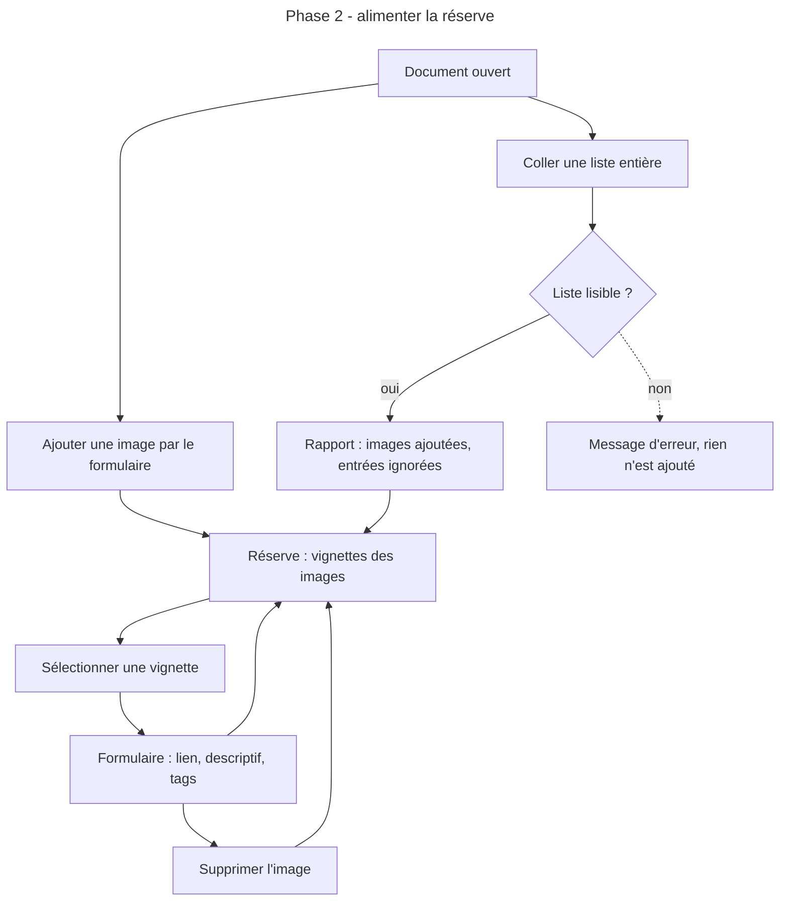
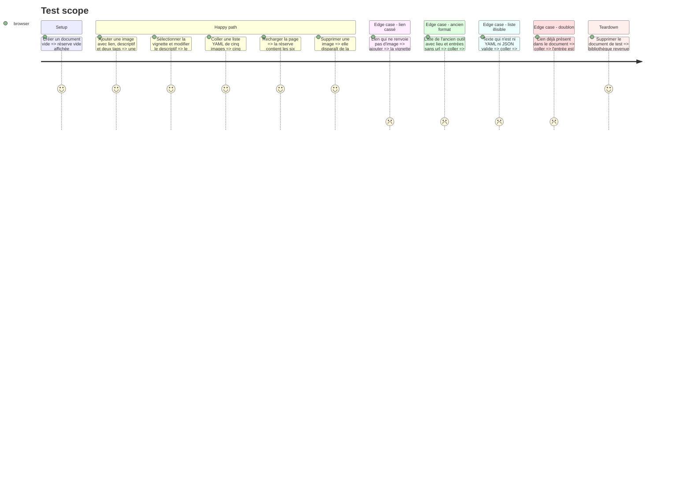

# Instruction: Images et réserve

## Architecture projection

> Tree of the final files. ✅ create · ✏️ modify · ❌ delete

```txt
Moodboard/atelier/src/
├── core/document/
│   ├── ✅ listImport.ts            analyse d'une liste collée (YAML ou JSON) en images
│   ├── ✅ listImport.test.ts
│   ├── ✅ images.ts                opérations pures : ajouter, modifier, supprimer une image
│   └── ✅ images.test.ts
├── core/workspace/
│   ├── ✏️ store.ts                 actions sur les images du document actif
│   └── ✏️ selectors.ts             images en réserve (non posées), image sélectionnée
├── editor/reserve/
│   ├── ✅ ReservePanel.tsx         vignettes des images non posées
│   ├── ✅ ReserveItem.tsx          vignette, état de chargement, tags
│   ├── ✅ ImportListDialog.tsx     collage d'une liste entière
│   └── ✅ useImageStatus.ts        chargement en cours, chargée, en échec
├── editor/inspector/
│   ├── ✅ Inspector.tsx            aiguille vers le formulaire de la sélection
│   ├── ✅ ImageForm.tsx            lien, descriptif, tags
│   └── ✅ TagsInput.tsx
└── app/
    └── ✏️ EditorView.tsx           branche la réserve et l'inspecteur
```

## User Journey



## Test Scope



## Wireframe

```txt
┌──────────────────────────────────────────────────────────────────────────────┐
│ (1) Barre haute                                                               │
├───────────────┬──────────────────────────────────────────────┬───────────────┤
│ (2) Réserve   │ (3) Zone des planches                         │ (4) Inspecteur │
│ [+ Image]     │                                               │  Lien          │
│ [Coller liste]│   vide à ce stade                             │  [__________]  │
│ ┌────┐ ┌────┐ │                                               │  Descriptif    │
│ │img │ │img │ │                                               │  [__________]  │
│ └────┘ └────┘ │                                               │  Tags          │
│ ┌────┐ ┌────┐ │                                               │  [tag][tag][+] │
│ │img │ │ !! │ │                                               │                │
│ └────┘ └────┘ │                                               │  [Supprimer]   │
└───────────────┴──────────────────────────────────────────────┴───────────────┘

┌──────────────────────────────────────────────┐
│ (5) Coller une liste                          │
│ ┌──────────────────────────────────────────┐ │
│ │ zone de texte YAML ou JSON                │ │
│ └──────────────────────────────────────────┘ │
│ (6) Rapport : ajoutées · ignorées · doublons  │
│                        [Annuler] [Ajouter]    │
└──────────────────────────────────────────────┘
```

1. Barre haute : inchangée.
2. Réserve : les images du document pas encore posées, et les deux façons d'en ajouter.
3. Zone des planches : remplie en phase 3.
4. Inspecteur : le formulaire de l'image sélectionnée.
5. Dialogue de collage : la liste préparée ailleurs.
6. Rapport : ce qui a été retenu et pourquoi le reste ne l'a pas été.

## Tasks to do

### `1)` Opérations sur les images

> Ajouter, modifier et supprimer une image sont des fonctions pures sur le document.

1. `images.ts` : ajout avec identifiant généré et focus centré par défaut, modification partielle, suppression.
2. La suppression d'une image retire aussi son cadre s'il existe.
3. Normaliser les tags : espaces rognés, vides écartés, doublons retirés.
4. Tests des trois opérations et de la normalisation.

### `2)` Analyse d'une liste collée

> Une liste préparée ailleurs devient des images, avec un compte rendu de ce qui a été écarté.

1. `listImport.ts` : accepter du YAML ou du JSON, soit un tableau d'images, soit un objet avec une clé `images`.
2. Champs lus : `url`, `descriptif` (alias `description`, `lieu`), `tags`.
3. Retourner trois listes : images retenues, entrées ignorées avec leur motif (pas de `url`, lien mal formé), doublons de liens déjà présents.
4. Ne rien modifier quand l'analyse échoue.
5. Tests sur une liste au nouveau format, une liste de l'ancien outil (`app/src/utils/exampleData.ts` comme référence de forme), un texte illisible.

### `3)` Réserve

> Les images non posées sont visibles et sélectionnables.

1. Sélecteur des images sans cadre.
2. `ReservePanel.tsx` et `ReserveItem.tsx` : vignette rognée, tags, état de chargement.
3. `useImageStatus.ts` : suivre chargement et échec de chaque lien, sans attribut `crossorigin` pour ne pas casser l'affichage des sites qui ne l'autorisent pas.

### `4)` Formulaire et collage

> Chaque image se décrit dans l'inspecteur, et une liste entière s'ajoute en une fois.

1. `ImageForm.tsx` et `TagsInput.tsx` : lien, descriptif, tags, suppression avec confirmation.
2. Bouton d'ajout : crée une image vide, la sélectionne, place le curseur dans le champ du lien.
3. `ImportListDialog.tsx` : zone de texte, aperçu du rapport avant validation, ajout.
4. Icônes prises dans lucide-react, uniquement sur des éléments interactifs ou pour signaler un état.

## Test acceptance criteria

| Task | Acceptance criteria                                                                                                                     |
| ---- | --------------------------------------------------------------------------------------------------------------------------------------- |
| 1    | Une image ajoutée apparaît dans le fichier YAML exporté avec son lien, son descriptif et ses tags.                                        |
| 1    | Supprimer une image la retire du document et de toute planche où elle figurait.                                                          |
| 2    | Une liste de l'ancien outil est acceptée : `lieu` alimente le descriptif, les entrées sans `url` sont listées comme ignorées.             |
| 2    | Un texte illisible produit un message d'erreur et laisse le document inchangé.                                                           |
| 3    | La réserve montre exactement les images du document qui ne sont posées sur aucune planche.                                               |
| 3    | Un lien qui ne charge pas est signalé sur sa vignette, sans bloquer les autres.                                                          |
| 4    | Modifier un champ du formulaire met à jour la vignette immédiatement et survit au rechargement.                                          |
| 4    | Le dialogue de collage annonce, avant validation, le nombre d'images qui seront ajoutées, ignorées et en doublon.                        |
