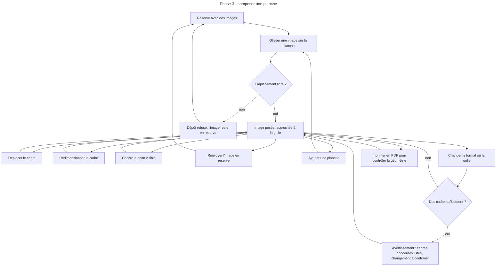
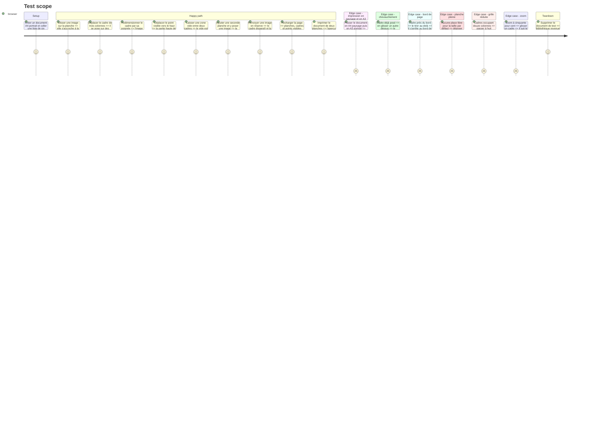

# Instruction: Planches et composition sur grille

## Architecture projection

> Tree of the final files. ✅ create · ✏️ modify · ❌ delete

```txt
Moodboard/atelier/
├── ✏️ package.json                 ajoute react-grid-layout 2.3
└── src/
    ├── core/document/
    │   ├── ✅ grid.ts               géométrie : cellule, rectangle d'un cadre, collision, limites, emplacement libre, configuration de la grille d'édition
    │   ├── ✅ grid.test.ts
    │   ├── ✅ pages.ts              opérations pures sur les planches et les cadres
    │   └── ✅ pages.test.ts
    ├── core/workspace/
    │   ├── ✏️ store.ts              actions planches et cadres, planche active, zoom
    │   └── ✏️ selectors.ts          planche active, cadre sélectionné
    ├── editor/board/
    │   ├── ✅ PageView.tsx          la planche aux dimensions fixes, en lecture seule : impression, capture, miniatures
    │   ├── ✅ Frame.tsx             un cadre : image rognée selon son focus, commun à la lecture seule et à l'édition
    │   ├── ✅ BoardCanvas.tsx       planche active en édition : mêmes dimensions, mise à l'échelle, glisser, redimensionner, dépôt
    │   ├── ✅ GridOverlay.tsx       repères de la grille en édition
    │   ├── ✅ PageStrip.tsx         bande des planches : ajouter, réordonner, supprimer
    │   └── ✅ usePageScale.ts       ajustement à la fenêtre et zoom
    ├── editor/reserve/
    │   └── ✏️ ReserveItem.tsx       devient source de glisser-déposer
    ├── editor/inspector/
    │   ├── ✏️ Inspector.tsx         cas cadre sélectionné, cas aucune sélection
    │   ├── ✅ FocusPicker.tsx       choix du point visible sur la vignette entière
    │   └── ✅ PageSettings.tsx      format de page, colonnes, rangées
    ├── export/
    │   ├── ✅ PrintDocument.tsx     toutes les planches, en lecture seule, pour l'impression
    │   ├── ✅ print.css             règles d'impression, une planche par page
    │   └── ✅ printPdf.ts           format de page injecté, attente des images, impression
    ├── app/
    │   ├── ✏️ App.tsx               monte le document d'impression
    │   ├── ✏️ AppTopBar.tsx         bouton Imprimer provisoire
    │   └── ✏️ EditorView.tsx        branche la zone des planches
    └── styles/
        └── ✏️ index.css             importe print.css
```

## User Journey



## Test Scope



## Wireframe

```txt
┌──────────────────────────────────────────────────────────────────────────────┐
│ (1) Barre haute : titre · documents · import/export · zoom                    │
├───────────────┬──────────────────────────────────────────────┬───────────────┤
│ (2) Réserve   │ (3) Planche active                            │ (4) Inspecteur │
│ ┌────┐ ┌────┐ │  ┌─────────────────────────────────────────┐ │  Cadre         │
│ │img │ │img │ │  │ ┌───────────────┐ ┌────────┐            │ │  (5) Point     │
│ └────┘ └────┘ │  │ │               │ │        │            │ │   visible      │
│ ┌────┐        │  │ │   cadre       │ │ cadre  │            │ │  ┌──────────┐  │
│ │img │        │  │ │               │ └────────┘            │ │  │ image  + │  │
│ └────┘        │  │ └───────────────┘                        │ │  └──────────┘  │
│               │  │          vide volontaire   ┌───────────┐ │ │  [En réserve]  │
│               │  │                            │  cadre  ◢ │ │ │                │
│               │  │                            └───────────┘ │ │  (6) Page      │
│               │  └─────────────────────────────────────────┘ │  format        │
│               ├──────────────────────────────────────────────┤  colonnes      │
│               │ (7) Planches : [1] [2] [3] [+]                │  rangées       │
└───────────────┴──────────────────────────────────────────────┴───────────────┘
```

1. Barre haute : gagne le réglage du zoom et un bouton Imprimer provisoire, remplacé par le dialogue d'export en phase 5.
2. Réserve : source des images à poser.
3. Planche active : la page au format fixe, mise à l'échelle de la fenêtre, avec ses cadres et sa poignée de redimensionnement.
4. Inspecteur : dépend de la sélection.
5. Point visible : vignette de l'image entière sur laquelle on désigne ce qui doit rester dans le cadre.
6. Page : réglages communs à toutes les planches du document, affichés quand rien n'est sélectionné.
7. Bande des planches : navigation, ajout, réordonnancement, suppression.

## Tasks to do

### `1)` Essai de la bibliothèque de grille

> Confirmer par un essai, avant d'écrire le reste, ce que la documentation de react-grid-layout 2.3 annonce.

1. Installer react-grid-layout 2.3 (React 19 accepté par sa dépendance paire, déjà vérifié).
2. Sur une grille d'essai jetable, constater quatre comportements : aucun tassement et collisions bloquées (`noCompactor`, `allowOverlap: false`, `preventCollision`) ; redimensionnement arrêté au bord et à `maxRows` ; dépôt d'un élément externe par glisser-déposer natif, refusable par `dropConfig.onDragOver` ; glisser sans décalage sous un parent réduit de moitié avec `createScaledStrategy`.
3. Si un des quatre échoue : écrire le glisser et le redimensionnement à la main sur les événements pointeur, `grid.ts` restant la seule source de la géométrie.
4. Supprimer la grille d'essai et consigner le choix et son motif dans la mémoire d'architecture.

### `2)` Géométrie et opérations de planche

> Toute règle de placement est une fonction pure testée, indépendante de l'interface.

1. `grid.ts` : taille d'une cellule à partir du format, de la marge et de la gouttière de l'apparence ; rectangle en pixels d'un cadre ; test de collision ; maintien dans les limites ; premier emplacement libre pour une taille donnée ; configuration de la grille d'édition (colonnes, hauteur de rangée, marge, retrait, nombre de rangées) dérivée des mêmes valeurs.
2. Le rectangle calculé par `grid.ts` reprend la formule et l'arrondi de la bibliothèque de grille, pour qu'un cadre occupe les mêmes pixels en édition et en lecture seule.
3. `pages.ts` : ajouter, supprimer, renommer, réordonner une planche ; poser, déplacer, redimensionner, retirer un cadre.
4. Supprimer une planche renvoie ses images en réserve.
5. Changement de format ou de grille : calculer la liste des cadres qui déborderaient.
6. Tests de chaque règle, dont les refus.

### `3)` Rendu de la planche

> La planche en lecture seule, à ses dimensions réelles ; son cadre resservira tel quel en édition.

1. `PageView.tsx` : élément aux dimensions exactes du format en pixels CSS, cadres positionnés depuis `grid.ts`, mode lecture seule sans aucun élément d'édition.
2. `Frame.tsx` : image en remplissage rogné, position réglée par le focus de l'image.
3. `usePageScale.ts` : ajuster la planche à la zone disponible par transformation, sans changer ses dimensions réelles ; zoom manuel.

### `4)` Essai d'impression PDF

> Savoir, avant de construire la composition et l'apparence, que la planche s'imprime à l'identique.

1. `PrintDocument.tsx` : toutes les planches du document en lecture seule, hors écran en temps normal ; le monter dans `App.tsx`.
2. `print.css` : à l'impression, masquer l'interface, afficher le document d'impression, une planche par page, aucun saut dans une planche, impression des fonds forcée.
3. `printPdf.ts` : injecter la règle de page aux dimensions du format du document, marges nulles ; attendre que toutes les images soient décodées ; déclencher l'impression ; retirer la règle ensuite.
4. Bouton Imprimer provisoire dans la barre haute.
5. Poser quelques cadres dans un document de test écrit en YAML et importé, puisque la composition à la souris n'existe pas encore.
6. Vérifier en A4 et en A3, en portrait et en paysage, puis en carré et en 16:9 (formats hors papier normalisé), dans Chrome et dans Firefox : une page par planche, aucune page blanche, cadres et rognages identiques à l'écran, images de sites protégés présentes.
7. Si l'arrondi des dimensions crée une page blanche : contraindre la planche par un conteneur aux dimensions en millimètres qui masque le dépassement.
8. Consigner dans la mémoire d'architecture ce qui a été constaté par navigateur. Si la fidélité n'est pas atteinte, arrêter la phase et le signaler avant d'écrire la composition.

### `5)` Composition

> Poser, déplacer et redimensionner à la souris, avec accrochage et sans chevauchement.

1. `BoardCanvas.tsx` : la grille interactive, configurée par `grid.ts`, rend les mêmes `Frame` que `PageView` ; l'échelle d'affichage lui est transmise.
2. `ReserveItem.tsx` : vignettes déplaçables par glisser-déposer natif, l'identifiant de l'image placé dans les données du glisser (Firefox l'exige pour démarrer).
3. Au dépôt, `grid.ts` décide : taille par défaut à l'emplacement visé s'il est libre, sinon au premier emplacement libre ; refus avec message quand la planche est pleine.
4. Refuser chevauchement et sortie de grille au déplacement et au redimensionnement.
5. `GridOverlay.tsx` : repères visibles pendant un déplacement.
6. Sélection d'un cadre au clic, retrait au clavier et par le bouton de l'inspecteur.

### `6)` Planches, réglages de page et point visible

> Gérer plusieurs planches et régler ce que montre chaque cadre.

1. `PageStrip.tsx` : miniatures, ajout, réordonnancement, suppression avec confirmation.
2. `PageSettings.tsx` : format, colonnes, rangées ; avertissement avec la liste des cadres concernés avant tout changement qui en ferait déborder.
3. `FocusPicker.tsx` : désigner le point visible sur l'image entière, avec retour immédiat dans le cadre.

## Test acceptance criteria

| Task | Acceptance criteria                                                                                                                            |
| ---- | ---------------------------------------------------------------------------------------------------------------------------------------------- |
| 1    | Le choix entre la bibliothèque et l'écriture à la main est consigné avec le résultat des quatre comportements essayés.                           |
| 2    | Deux cadres ne peuvent jamais occuper une même cellule, quelle que soit la suite d'opérations.                                                  |
| 2    | Supprimer une planche fait revenir toutes ses images dans la réserve.                                                                           |
| 3    | Une planche A4 portrait mesure 794 × 1123 pixels CSS quel que soit le zoom affiché.                                                             |
| 3    | En lecture seule, la planche ne contient ni poignée, ni repère de grille, ni marque de sélection.                                               |
| 4    | Le PDF imprimé compte exactement une page par planche, au format et à l'orientation du document, sans marge ni page blanche ajoutée.            |
| 4    | Chaque page du PDF montre les mêmes cadres et les mêmes rognages que la planche à l'écran, images de sites protégés comprises.                  |
| 4    | Le résultat de l'essai est consigné par navigateur, avec le contournement retenu s'il en a fallu un.                                            |
| 4    | Les six formats du document s'impriment à leurs dimensions, formats carré et 16:9 compris.                                                      |
| 5    | Un même cadre occupe le même rectangle, au pixel près, sur la planche en édition et sur la planche en lecture seule.                            |
| 5    | Un cadre déposé, déplacé ou redimensionné se trouve toujours sur des limites de cellules.                                                       |
| 5    | Un déplacement vers un emplacement occupé ou hors grille est refusé et le cadre retrouve sa position.                                           |
| 5    | Les vides laissés entre les cadres sont conservés après toute opération et après rechargement.                                                  |
| 6    | Changer le point visible d'une image modifie ce que montre son cadre, et ce réglage figure dans le fichier YAML.                                |
| 6    | Réduire la grille quand des cadres déborderaient exige une confirmation qui les nomme.                                                          |
