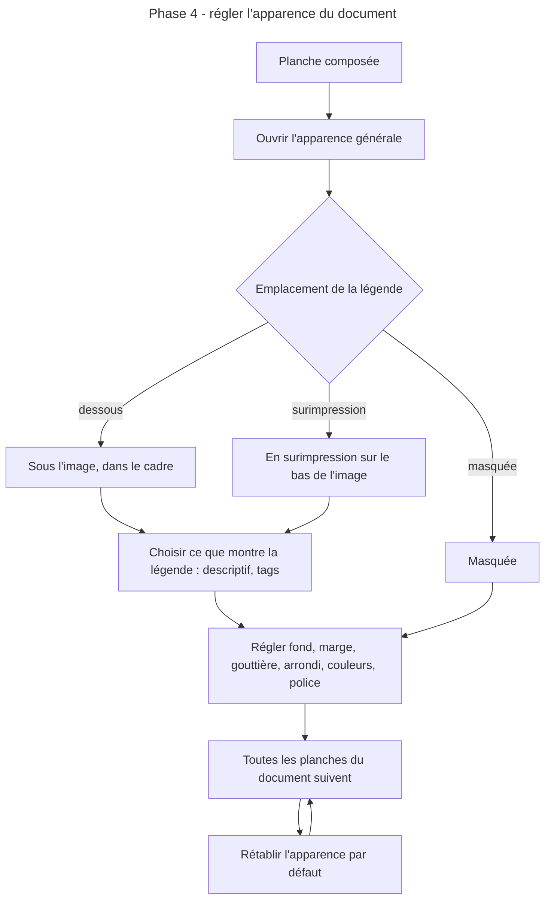
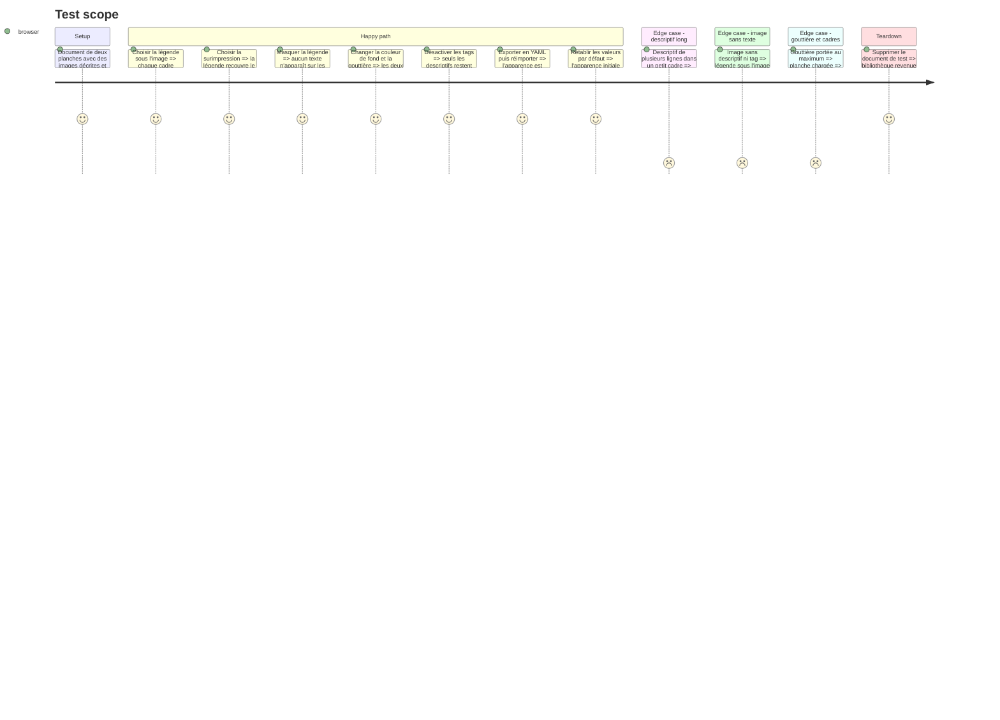

# Instruction: Apparence générale et légendes

## Architecture projection

> Tree of the final files. ✅ create · ✏️ modify · ❌ delete

```txt
Moodboard/atelier/
├── ✏️ package.json                    ajoute @fontsource-variable/inter, @fontsource/pt-serif, @fontsource/bebas-neue
└── src/
    ├── ✏️ main.tsx                    importe les polices embarquées
    ├── core/document/
    │   ├── ✏️ schema.ts               détail du bloc apparence
    │   ├── ✏️ schema.test.ts
    │   ├── ✏️ model.ts                apparence par défaut
    │   ├── ✅ appearance.ts           apparence vers variables CSS de la planche
    │   └── ✅ appearance.test.ts
    ├── core/workspace/
    │   └── ✏️ store.ts                action de mise à jour de l'apparence
    ├── editor/board/
    │   ├── ✏️ PageView.tsx            applique les variables d'apparence
    │   ├── ✏️ Frame.tsx               réserve la place de la légende selon son emplacement
    │   ├── ✅ Caption.tsx             descriptif et tags
    │   └── ✅ board.css               styles de la planche, portés par des variables
    ├── editor/inspector/
    │   ├── ✏️ Inspector.tsx           onglet Apparence quand rien n'est sélectionné
    │   └── ✅ AppearancePanel.tsx     réglages de l'apparence générale
    └── styles/
        └── ✏️ index.css               importe board.css
```

## User Journey



## Test Scope



## Wireframe

```txt
┌──────────────────────────────────────────────────────────────────────────────┐
│ (1) Barre haute                                                               │
├───────────────┬──────────────────────────────────────────────┬───────────────┤
│ (2) Réserve   │ (3) Planche active                            │ (4) Inspecteur │
│               │  ┌─────────────────────────────────────────┐ │ [Page][Appar.] │
│               │  │ ┌───────────────┐ ┌────────┐            │ │ (5) Légende    │
│               │  │ │    image      │ │ image  │            │ │  emplacement   │
│               │  │ ├───────────────┤ │▒légende│            │ │  descriptif ☐  │
│               │  │ │ descriptif    │ └────────┘            │ │  tags ☐        │
│               │  │ │ [tag] [tag]   │   (7) surimpression   │ │ (6) Habillage  │
│               │  │ └───────────────┘                        │ │  fond          │
│               │  │   (7) sous l'image                       │ │  marge         │
│               │  └─────────────────────────────────────────┘ │  gouttière     │
│               ├──────────────────────────────────────────────┤  arrondi       │
│               │ Planches : [1] [2] [+]                        │  texte, tags   │
│               │                                               │  police        │
│               │                                               │ [Rétablir]     │
└───────────────┴──────────────────────────────────────────────┴───────────────┘
```

1. Barre haute : inchangée.
2. Réserve : inchangée.
3. Planche active : reflète immédiatement chaque réglage.
4. Inspecteur : deux onglets quand rien n'est sélectionné, Page et Apparence.
5. Légende : emplacement et contenu, communs à tout le document.
6. Habillage : les réglages visuels de la planche.
7. Les deux emplacements possibles de la légende, montrés côte à côte pour la lecture du schéma ; un seul s'applique à la fois.

## Tasks to do

### `1)` Modèle d'apparence

> L'apparence est une partie du document, exportée avec lui.

1. `schema.ts` : ajouter à `marge` et `gouttiere`, présentes depuis la phase 1, `legende.emplacement` (`dessous`, `surimpression`, `masquee`), `legende.descriptif`, `legende.tags`, `fond`, `arrondi`, `couleur_texte`, `couleur_tags`, `police`, `taille_texte`, chacun borné.
2. `model.ts` : valeurs par défaut ; un fichier ou un document sauvegardé sans ces champs les reçoit.
3. `appearance.ts` : traduire l'apparence en variables CSS posées sur la planche.
4. Tests : valeurs par défaut, bornes, traduction en variables, document de la phase 3 rouvert sans perte.

### `2)` Légendes

> Chaque cadre affiche son descriptif et ses tags à l'emplacement choisi pour le document.

1. `Caption.tsx` : descriptif puis tags, selon ce que l'apparence active.
2. `Frame.tsx` : sous l'image, la légende prend sa hauteur dans le cadre et l'image garde une hauteur minimale ; en surimpression, elle recouvre le bas de l'image sur un fond qui assure la lisibilité.
3. Tronquer le texte qui dépasse plutôt que d'agrandir le cadre.
4. Aucune zone de légende pour une image sans descriptif ni tag.
5. `board.css` : tous les styles de planche passent par les variables, sans valeur dépendant de l'interface d'édition.

### `3)` Panneau d'apparence

> Tous les réglages sont modifiables et visibles en direct.

1. `AppearancePanel.tsx` : les réglages du wireframe, avec retour immédiat sur la planche.
2. Choix de police parmi trois familles embarquées avec l'application par `@fontsource` (Inter, PT Serif, Bebas Neue), jamais chargées depuis un service distant, pour que l'export ne dépende pas du réseau.
3. Bouton de rétablissement des valeurs par défaut, avec confirmation.

## Test acceptance criteria

| Task | Acceptance criteria                                                                                                                       |
| ---- | ----------------------------------------------------------------------------------------------------------------------------------------- |
| 1    | Un document exporté puis réimporté retrouve exactement son apparence.                                                                      |
| 1    | Un fichier sans bloc apparence s'ouvre avec les valeurs par défaut.                                                                        |
| 1    | Modifier marge ou gouttière ne produit ni chevauchement ni cadre hors page.                                                                |
| 2    | Les trois emplacements de légende donnent trois rendus distincts sur toutes les planches du document.                                      |
| 2    | Un descriptif trop long est tronqué sans modifier la taille de son cadre.                                                                  |
| 2    | Une image sans descriptif ni tag n'affiche aucune zone de légende.                                                                         |
| 3    | Chaque réglage du panneau modifie la planche sans rechargement et survit au rechargement.                                                  |
| 3    | Les polices proposées s'affichent sans connexion réseau.                                                                                   |
