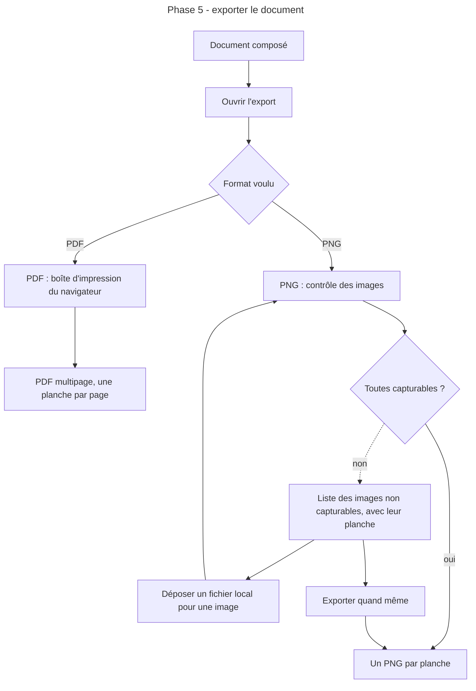
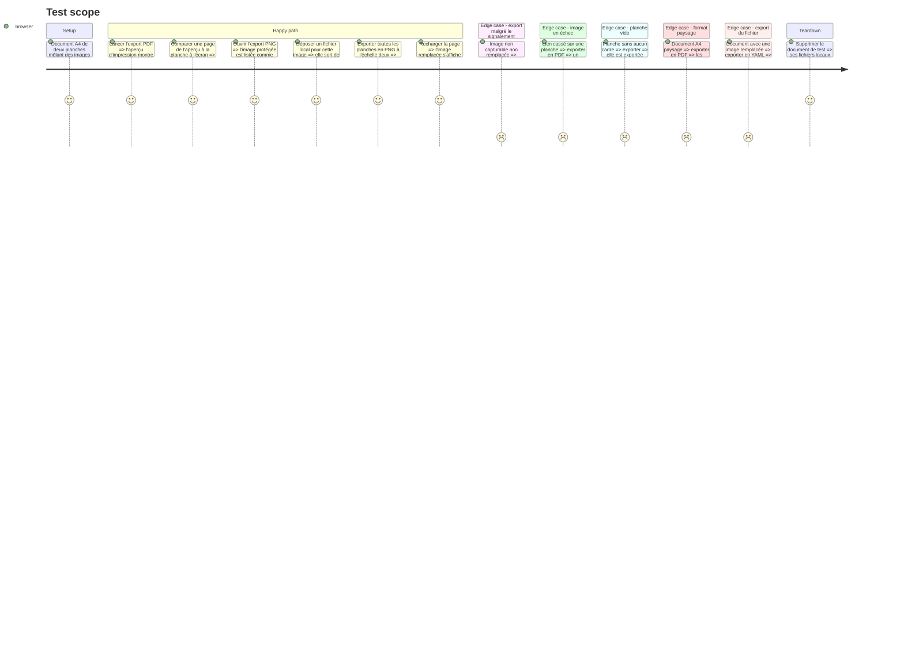

# Instruction: Export PDF, export PNG, fichiers locaux

## Architecture projection

> Tree of the final files. ✅ create · ✏️ modify · ❌ delete

```txt
Moodboard/atelier/
├── ✏️ package.json                    ajoute @zumer/snapdom 3.3 et, en développement, fake-indexeddb 6.2
├── ✏️ README.md                       décrit les exports et leurs limites
├── ✏️ aidd_docs/memory/architecture.md consigne les décisions et pièges d'export
└── src/
    ├── core/assets/
    │   ├── ✅ localFiles.ts           fichiers de remplacement en IndexedDB
    │   ├── ✅ localFiles.test.ts
    │   ├── ✅ capturability.ts        test de lisibilité inter-domaines d'un lien
    │   └── ✅ useImageSource.ts       source effective d'une image : fichier local ou lien
    ├── core/workspace/
    │   └── ✏️ store.ts                supprimer une image ou un document purge ses fichiers locaux
    ├── export/
    │   ├── ✏️ printPdf.ts             avertissement sur les images en échec et les planches vides
    │   ├── ✅ exportPng.ts            capture d'une planche ou de toutes
    │   ├── ✅ fileNames.ts            noms de fichiers à partir du titre
    │   ├── ✅ fileNames.test.ts
    │   └── ✅ ExportPanel.tsx         choix de l'export, échelle, images à problème
    ├── editor/board/
    │   └── ✏️ Frame.tsx               lit la source effective de l'image
    ├── editor/reserve/
    │   └── ✏️ ReserveItem.tsx         lit la source effective, marque les images remplacées
    ├── editor/inspector/
    │   └── ✏️ ImageForm.tsx           déposer un fichier de remplacement, le retirer
    └── app/
        └── ✏️ AppTopBar.tsx           bouton Exporter, à la place du bouton Imprimer provisoire
```

## User Journey



## Test Scope



## Wireframe

```txt
┌──────────────────────────────────────────────────────┐
│ (1) Exporter                                          │
├──────────────────────────────────────────────────────┤
│ (2) PDF multipage                                     │
│     toutes les planches · format du document          │
│                                        [Imprimer…]    │
├──────────────────────────────────────────────────────┤
│ (3) Images PNG                                        │
│     portée : planche active / toutes                  │
│     échelle : 1 · 2 · 3                               │
│ (4) Images non capturables                            │
│  ┌──────────────────────────────────────────────────┐ │
│  │ vignette · planche 2 · domaine   [Remplacer…]     │ │
│  │ vignette · planche 3 · domaine   [Remplacer…]     │ │
│  └──────────────────────────────────────────────────┘ │
│                                        [Exporter]     │
├──────────────────────────────────────────────────────┤
│ (5) Fichier YAML                       [Télécharger]  │
└──────────────────────────────────────────────────────┘
```

1. Dialogue d'export : regroupe les trois sorties.
2. PDF : l'export de référence, par la boîte d'impression du navigateur.
3. PNG : portée et échelle de la capture.
4. Images non capturables : ce que le contrôle a trouvé, avec le moyen d'y remédier sur place.
5. Fichier YAML : l'export du document, déplacé ici depuis la barre haute.

## Tasks to do

### `1)` Export PDF par impression

> L'impression mise en place en phase 3 devient l'export de référence, légendes et apparence comprises.

1. `printPdf.ts` : avertir avant l'impression si des images sont en échec de chargement, en les nommant ; signaler les planches vides.
2. Rejouer le contrôle de la phase 3 (A4 et A3, portrait et paysage, Chrome et Firefox) avec les trois emplacements de légende, les polices embarquées et un fond coloré.
3. Vérifier qu'une image servie par un fichier local s'imprime.
4. Corriger tout écart constaté et compléter la mémoire d'architecture.

### `2)` Fichiers locaux de remplacement

> Une image peut être servie depuis un fichier du disque, conservé dans le navigateur.

1. `localFiles.ts` : enregistrer, lire, supprimer un fichier par identifiant d'image, en IndexedDB ; lister ceux d'un document.
2. `useImageSource.ts` : rendre la source effective d'une image, le fichier local s'il existe, le lien sinon ; libérer les adresses temporaires.
3. `Frame.tsx` et `ReserveItem.tsx` : passer par cette source.
4. `ImageForm.tsx` : déposer un fichier image, voir qu'un remplacement est actif, le retirer.
5. Purger les fichiers d'une image supprimée et d'un document supprimé.
6. Tests de `localFiles.ts` avec fake-indexeddb.

### `3)` Contrôle de capturabilité

> Savoir avant de capturer quelles images manqueront.

1. `capturability.ts` : pour chaque lien, tenter une lecture inter-domaines et classer en capturable ou non ; une image servie par un fichier local est toujours capturable.
2. Faire ce test par une requête qui ignore le cache du navigateur, sans modifier le lien : une image déjà affichée sans mode inter-domaines fausserait le résultat, et un paramètre ajouté casserait les liens signés.
3. Mémoriser le résultat par lien pour la session.

### `4)` Export PNG

> Une image par planche, à l'échelle choisie, sans mauvaise surprise.

1. `exportPng.ts` : capturer avec snapdom 3 une planche en lecture seule à ses dimensions réelles, polices embarquées. La planche capturée est montée le temps de la capture dans un conteneur rendu mais placé hors de la vue, sans mise à l'échelle : ni la planche de l'éditeur (réduite par transformation) ni le document d'impression (non rendu à l'écran) ne conviennent.
2. Régler la résolution par l'option de densité de snapdom 3 et vérifier que le fichier produit mesure bien le format multiplié par l'échelle choisie.
3. Porter sur la planche active ou sur toutes, téléchargées l'une après l'autre.
4. `fileNames.ts` : `titre-planche-01@2x.png`, titre nettoyé pour le système de fichiers ; tests.
5. Constater le comportement réel de snapdom sur une image non capturable (bloc de substitution, contenu de `warnings`) et l'aligner sur ce que le dialogue annonce ; si le contrôle préalable et la capture se contredisent, la capture fait foi. Consigner le résultat dans la mémoire d'architecture.

### `5)` Dialogue d'export

> Un seul endroit pour les trois sorties et pour corriger ce qui bloque.

1. `ExportPanel.tsx` : les cinq zones du wireframe.
2. Lancer le contrôle de capturabilité à l'ouverture de la section PNG ; lister les images concernées avec leur planche et leur domaine.
3. Remplacement d'une image depuis la liste, avec nouveau contrôle immédiat.
4. Export YAML déplacé ici, avec l'avertissement sur les fichiers locaux non inclus.
5. Mettre à jour `README.md` et la mémoire d'architecture.

## Test acceptance criteria

| Task | Acceptance criteria                                                                                                                                   |
| ---- | ----------------------------------------------------------------------------------------------------------------------------------------------------- |
| 1    | Le PDF compte toujours exactement une page par planche, sans marge ni page blanche, quels que soient l'emplacement de la légende et l'apparence.        |
| 1    | Chaque page du PDF montre les mêmes cadres, rognages, légendes, polices et fonds que la planche à l'écran, images remplacées comprises.                 |
| 1    | Une image en échec de chargement est nommée dans un avertissement avant l'ouverture de l'impression.                                                    |
| 1    | Aucun élément d'interface (poignée, repère, sélection, panneau) n'apparaît dans le PDF.                                                                 |
| 2    | Une image remplacée s'affiche depuis le fichier local dans la réserve, sur la planche et dans les exports, y compris après rechargement.                |
| 2    | Supprimer une image ou un document ne laisse aucun de ses fichiers locaux dans le navigateur.                                                           |
| 3    | Une image d'un site qui interdit la lecture inter-domaines est classée non capturable, une image d'un site ouvert est classée capturable.               |
| 4    | L'export de toutes les planches produit un fichier PNG par planche, dont les dimensions valent celles du format multipliées par l'échelle.              |
| 4    | Un PNG exporté malgré une image non capturable contient un bloc de substitution à son emplacement et le reste de la planche intact.                     |
| 5    | Le dialogue liste les images non capturables avec leur planche avant toute capture, et la liste se vide à mesure qu'elles sont remplacées.              |
| 5    | L'export YAML d'un document contenant une image remplacée prévient que le fichier local n'est pas inclus.                                               |
